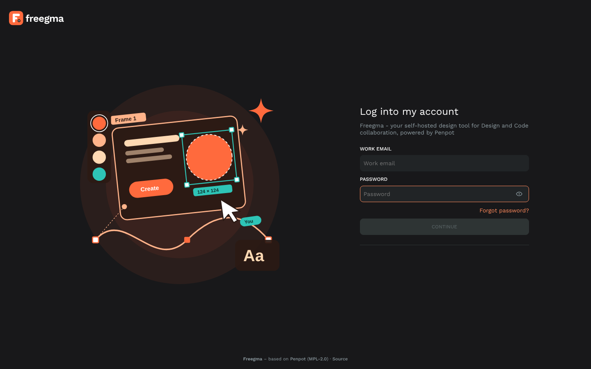
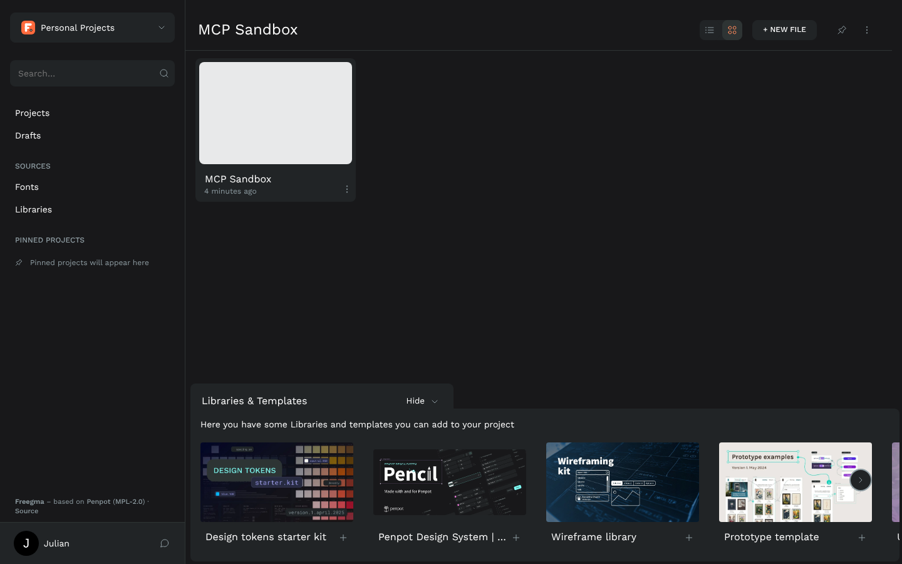
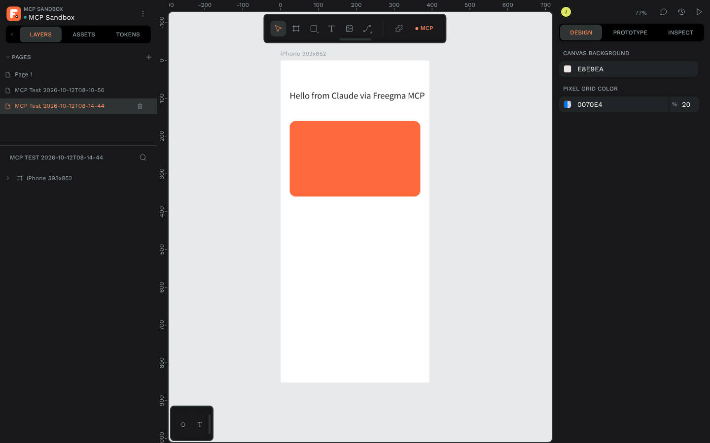

<p align="center">
  
</p>

<h1 align="center">Freegma</h1>

<p align="center">
  <b>Your own design tool. Self-hosted, branded, and ready for Claude.</b><br>
  Freegma packages <a href="https://penpot.app">Penpot</a>, the open-source design platform, as a one-command Docker stack
  with its own branding, HTTPS, backups, safe updates and a built-in <b>MCP server</b> so AI assistants like Claude can read and create designs.
</p>

<p align="center">
  <a href="https://github.com/julianhintermann-cmd/Freegma/actions/workflows/ci.yml"></a>
  <a href="https://github.com/julianhintermann-cmd/Freegma/actions/workflows/images.yml"></a>
  
  
  
</p>

<p align="center">
  
</p>

---

## Contents

- [Why Freegma?](#why-freegma)
- [Features](#features)
- [How it works](#how-it-works)
- [Requirements](#requirements)
- [Quick start (5 steps)](#quick-start-5-steps)
- [Configuration](#configuration)
- [HTTPS and access](#https-and-access)
- [Users and invitations](#users-and-invitations)
- [Connect Claude via MCP](#connect-claude-via-mcp)
- [Branding](#branding)
- [Backup and restore](#backup-and-restore)
- [Updating](#updating)
- [Health checks and monitoring](#health-checks-and-monitoring)
- [Docker images](#docker-images)
- [Command reference](#command-reference)
- [Troubleshooting](#troubleshooting)
- [Project layout](#project-layout)
- [License, attribution and trademarks](#license-attribution-and-trademarks)

## Why Freegma?

Figma is great, but it lives in someone else's cloud, its MCP server comes with
tool-call limits, and your files are not really yours. Penpot is a powerful
open-source alternative, but running it well at home takes some work:
compose files, secrets, HTTPS, backups, upgrades, MCP keys.

**Freegma does that work for you.** You get Penpot, unmodified and pinned to a
tested release, plus everything around it to run it as your own product:

- your **own name and look** (logo, favicon, colours, login screen) without forking Penpot,
- **HTTPS** with one setting, and private by default (LAN or Tailscale),
- an **MCP endpoint** Claude Code and Claude Desktop can use, with no per-call limits,
- **backups, restores and updates** that are scripted, tested and roll back on failure.

Updating Penpot is a version bump: `make update VERSION=x.y.z`.

## Features

| | |
|---|---|
| **Penpot 2.18.3** | Official images (`frontend`, `backend`, `exporter`, `mcp`), unmodified, pinned. |
| **Branding without a fork** | A small proxy swaps logo, favicon, accent colour, login artwork and selected UI texts at delivery time. Edit everything in `branding/`. |
| **Built-in MCP server** | Penpot's official MCP server in multi-user mode at `https://<your-host>/mcp/stream`. Works with Claude Code, Claude Desktop and other MCP clients. |
| **Private by default** | Public sign-up is disabled. Accounts are created by the admin. Only the edge proxy publishes ports (443 + 80 redirect; the plain-HTTP port stays on 127.0.0.1). |
| **HTTPS** | Caddy with its own local CA (LAN/Tailscale) or Let's Encrypt. Or bring your own reverse proxy. |
| **Backups** | Database + assets + config + certificates, verified, rotated (7 daily / 4 weekly), cron-ready. |
| **Restore** | Into the running stack or onto a brand-new machine (`--with-env`). Tested. |
| **Safe updates** | Backup → bump → pull → health check → smoke test → **automatic rollback** (including the database). |
| **Tests included** | `make smoke` (health, branding, security, login, browser) and `make mcp-test` (Claude-style end-to-end). |
| **Multi-arch images** | `linux/amd64` and `linux/arm64` on GHCR and Docker Hub. |

<p align="center">
  
  
</p>
<p align="center"><sub>Left: dashboard. Right: a 393×852 frame created by <code>make mcp-test</code> through the MCP server ("● MCP" = connected).</sub></p>

## How it works

```
                      LAN / Tailscale only
  Browser ─────────┐
  Claude Code ─────┤  https://freegma.home.arpa
  Claude Desktop ──┘           │
                               ▼
                    ┌─────────────────────┐   profile "https" (optional)
                    │ caddy :443          │   TLS: internal CA or Let's Encrypt
                    └──────────┬──────────┘
                               ▼
                    ┌─────────────────────┐   ghcr.io/…/freegma (this repo)
                    │ freegma :8080       │   injects branding into index.html
                    │ (branding proxy)    │   and UI texts; everything else
                    └──────────┬──────────┘   passes through untouched
                               ▼
                    ┌─────────────────────┐   penpotapp/frontend (official)
                    │ penpot-frontend     │   nginx: SPA, /api, /ws, /mcp/*
                    └──┬───────┬───────┬──┘
          /api, /ws    │       │       │  /mcp/stream (AI clients)
                       ▼       │       ▼  /mcp/ws     (plugin in your browser tab)
      ┌────────────────┐       │   ┌────────────────┐
      │ penpot-backend │       │   │ penpot-mcp     │  official MCP server
      │ (JVM)          │       │   │ --multi-user   │  (tools: execute_code,
      └──┬──────────┬──┘       │   └────────────────┘   export_shape, …)
         ▼          ▼          ▼
   ┌──────────┐ ┌────────┐ ┌─────────────────┐
   │ postgres │ │ valkey │ │ penpot-exporter │  PNG/SVG/PDF export
   │ 15.19    │ │ 8.1.10 │ │ (headless)      │
   └──────────┘ └────────┘ └─────────────────┘
   volumes: freegma_postgres, freegma_assets, freegma_caddy_data
```

**How MCP works with Penpot.** The MCP server does not edit files on its own.
It forwards each tool call to the **Penpot MCP plugin**, which runs inside
the Penpot tab you have open. The plugin starts automatically when you
open a design file and MCP is enabled for your account. Claude therefore
always works on the page that is in focus in that tab. **Keep the tab open
while Claude works.**

More detail: [docs/ARCHITECTURE.md](docs/ARCHITECTURE.md).

## Requirements

| | Minimum | Recommended |
|---|---|---|
| CPU | 2 cores, `x86_64` or `arm64` | 4 cores |
| RAM | 4 GB (set `PENPOT_JVM_OPTS=-Xmx1g`) | 8 GB+ |
| Disk | 10 GB for images + your data | SSD, separate backup target |
| Software | Docker Engine 24+ with Compose v2.24+, `make` (optional), `curl` | |
| Network | A hostname that resolves to the server (local DNS, router, hosts file or Tailscale) | |

Measured on Penpot 2.18.3, idle: backend ~1–1.7 GB (JVM), everything else together ~0.5 GB.
The penpot images are ~5.5 GB to download the first time (the optional `freegma-tools` image adds ~3.6 GB).

Check your machine first:

```bash
uname -m                      # x86_64 -> amd64, aarch64 -> arm64 (both supported)
docker version && docker compose version
free -h && df -h
```

## Quick start (5 steps)

```bash
# 1. Get Freegma
git clone https://github.com/julianhintermann-cmd/Freegma.git freegma && cd freegma

# 2. Create .env with fresh secrets (pick your hostname)
make init DOMAIN=freegma.home.arpa
#    no make? -> ./scripts/init.sh --domain freegma.home.arpa

# 3. Start (pulls the images on first run, waits until every container is healthy)
make up

# 4. Create your account (public registration is disabled)
make admin EMAIL=you@example.com NAME="Your Name"

# 5. Open https://freegma.home.arpa and log in
```

Make sure the hostname resolves to your server, for example with a DNS
record in your router, Pi-hole or AdGuard, or as a quick test, a line
`192.168.1.50  freegma.home.arpa` in your computer's hosts file. With the
default `FREEGMA_TLS=internal`, your browser warns until you trust Freegma's
root certificate once (see [HTTPS and access](#https-and-access)).

Then connect Claude: [Connect Claude via MCP](#connect-claude-via-mcp).

> **Quick local test without HTTPS:** `make init DOMAIN=localhost HTTP_ONLY=1 && make up` → <http://localhost:9001>

## Configuration

Everything lives in `.env`, created from [`.env.example`](.env.example) by `make init`.
**Never commit `.env`**; it contains your secrets (it is in `.gitignore`).

| Variable | Default | Meaning |
|---|---|---|
| `PENPOT_VERSION` | `2.18.3` | Penpot release for all `penpot*` images. Change it with `make update`. |
| `FREEGMA_IMAGE` / `FREEGMA_VERSION` | `ghcr.io/julianhintermann-cmd/freegma` / `1.0.0` | Branding proxy image. Use the Docker Hub name instead if you prefer. |
| `FREEGMA_DOMAIN` | `freegma.home.arpa` | Hostname users open. |
| `FREEGMA_PUBLIC_URI` | `https://freegma.home.arpa` | Full URL (scheme, plus port if not 443). Penpot builds links and the MCP URL from it. |
| `COMPOSE_PROFILES` | `https` | Optional services: `https` (Caddy), `mailpit` (mail catcher). |
| `FREEGMA_TLS` | `internal` | `internal` = own CA; an e-mail address = Let's Encrypt. |
| `FREEGMA_HTTPS_PORT` / `FREEGMA_HTTPS_BIND` | `443` / `0.0.0.0` | Where Caddy listens. Bind to a LAN or Tailscale IP to restrict access. |
| `FREEGMA_HTTP_REDIRECT_PORT` | `80` | Caddy's HTTP→HTTPS redirect port (must be 80 for Let's Encrypt). |
| `FREEGMA_HTTP_PORT` / `FREEGMA_HTTP_BIND` | `9001` / `127.0.0.1` | Plain-HTTP port of the branding proxy (for your own reverse proxy). |
| `FREEGMA_BRAND_NAME` | `Freegma` | Name in titles, texts and attribution. |
| `FREEGMA_ACCENT_DARK` / `FREEGMA_ACCENT_LIGHT` | *(empty)* | Accent colour overrides for the dark and light UI themes. |
| `FREEGMA_REBRAND_TEXT` | `true` | Apply `branding/text-replacements.tsv`. |
| `FREEGMA_SHOW_ATTRIBUTION` | `true` | Show "Freegma – based on Penpot (MPL-2.0)" on the login screen and dashboard. |
| `FREEGMA_SES_OVERRIDE_TAMING` | `severe` | Plugin-sandbox fixes. `severe`/`moderate` prevent "Internal Error" crashes (`"toString" is read-only`) once a plugin such as MCP runs; `off` = unmodified Penpot behaviour. |
| `FREEGMA_MCP_BACKGROUND` | `true` | Keep MCP working while the Freegma tab is in the background. |
| `PENPOT_SECRET_KEY` | *generated* | Master key (sessions, invitations, MCP keys). Keep it and back it up. |
| `POSTGRES_PASSWORD` | *generated* | Database password. |
| `PENPOT_EXTRA_FLAGS` | `enable-access-tokens` | Extra [Penpot flags](https://help.penpot.app/technical-guide/configuration/), e.g. `enable-smtp`, `enable-webhooks`. |
| `PENPOT_JVM_OPTS` | *(empty)* | JVM flags for the backend, e.g. `-Xmx1g` on small machines. |
| `PENPOT_DISABLE_IPV6_LISTEN` | `false` | Set to `true` on hosts with IPv6 disabled (`make init` detects this). |
| `PENPOT_HTTP_SERVER_MAX_BODY_SIZE` | `367001600` | Upload limit in bytes (350 MiB). |
| `FREEGMA_TOOLS_HOST_IP` | `127.0.0.1` | Address the test tools use for `FREEGMA_DOMAIN` (set it to the IP Caddy is bound to). |
| `PENPOT_SMTP_*` | Mailpit | Real e-mail: add `enable-smtp` to `PENPOT_EXTRA_FLAGS` and fill these in. |
| `FREEGMA_MCP_TOKEN` | *(empty)* | Written by `make mcp-token`. |
| `BACKUP_DIR` / `BACKUP_KEEP_DAILY` / `BACKUP_KEEP_WEEKLY` | `./backups` / `7` / `4` | Backup target and rotation. Point `BACKUP_DIR` at a NAS share. |

Penpot flags that Freegma always sets (in `docker-compose.yml`):
`disable-registration enable-login-with-password disable-email-verification disable-onboarding enable-prepl-server enable-mcp`.
Telemetry is off by default (`PENPOT_TELEMETRY_ENABLED=false`).

After changing `.env`: `make up` (only changed containers are recreated).
Branding settings (`FREEGMA_*`) are applied with `make branding`.

## HTTPS and access

Freegma is meant to be reachable **only on your LAN or tailnet**. Do not
port-forward it to the internet. If you must, use Let's Encrypt, strong
passwords and keep registration disabled.

### Option A: Caddy with Freegma's own CA (default)

`COMPOSE_PROFILES=https`, `FREEGMA_TLS=internal`. Caddy creates a private
certificate authority and issues the certificate for `FREEGMA_DOMAIN`.
Trust that CA once per device:

```bash
make ca-cert       # writes ./freegma-root-ca.crt
```

| Device | How to trust `freegma-root-ca.crt` |
|---|---|
| Windows | Double-click → *Install Certificate* → *Local Machine* → *Trusted Root Certification Authorities* |
| macOS | Open in Keychain Access → *System* → set *Trust* to *Always Trust* |
| Linux (Debian/Ubuntu) | `sudo cp freegma-root-ca.crt /usr/local/share/ca-certificates/ && sudo update-ca-certificates` |
| Firefox | Settings → Certificates → *View Certificates* → *Authorities* → *Import* |
| iOS / iPadOS | AirDrop or mail the file → install the profile → *Settings → General → About → Certificate Trust Settings* → enable |
| Android | *Settings → Security → Encryption & credentials → Install a certificate → CA certificate* |

The CA is included in every backup, so devices keep trusting Freegma after a restore.

### Option B: Let's Encrypt

Set `FREEGMA_TLS=you@example.com`. Caddy obtains a real certificate via the
HTTP-01/TLS-ALPN-01 challenge, which needs ports 80/443 reachable from the
internet for that hostname. For **LAN-only** hosts with a real domain, use a
DNS challenge instead: build Caddy with your DNS provider's plugin
(`xcaddy build --with github.com/caddy-dns/<provider>`) and set
`tls { dns <provider> <token> }` in [`caddy/Caddyfile`](caddy/Caddyfile).

### Option C: your own reverse proxy (NPM, Traefik, Synology/UGOS proxy, …)

Remove `https` from `COMPOSE_PROFILES`, set `FREEGMA_HTTP_BIND=0.0.0.0`, stop
the bundled Caddy if it was running (`docker compose rm -sf caddy`), and
point your proxy at `http://<server>:9001`. Requirements for the proxy:
WebSockets enabled (`/ws/notifications`, `/mcp/ws`), no response buffering
for `/mcp/stream`, upload limit ≥ 350 MB, and the `X-Forwarded-Proto` header set.
Set `FREEGMA_PUBLIC_URI` to the URL your proxy serves.

### Option D: Tailscale

Install Tailscale on the server and use its MagicDNS name as `FREEGMA_DOMAIN`
(e.g. `nas.tailnet-name.ts.net`). Either keep Caddy with `FREEGMA_TLS=internal`
and bind it to the Tailscale IP (`FREEGMA_HTTPS_BIND=100.x.y.z`), or use
`tailscale serve --https=443 http://127.0.0.1:9001` with Option C (real
certificates, nothing else exposed).

## Users and invitations

Public registration is **disabled**. In Penpot this also disables sign-up
through invitation links, so accounts are always created by the admin:

```bash
make user EMAIL=friend@example.com NAME="Friend"     # prompts for a password
```

Then invite them to your team in the UI (*Team → Invitations*). Existing
users accept invitations by logging in. To deliver invitation e-mails, either
configure SMTP (`enable-smtp` plus the `PENPOT_SMTP_*` variables) or add
`enable-log-invitation-tokens` to `PENPOT_EXTRA_FLAGS` and copy the link from
`make logs S=penpot-backend`. For testing, `COMPOSE_PROFILES=https,mailpit`
catches all mail at <http://127.0.0.1:8025>.

Passwords can be changed by each user under *Your account → Password*.

## Connect Claude via MCP

### 1. Enable MCP and get your key

```bash
make mcp-token            # asks for your Freegma login
```

This is the same as *Your account → Integrations → MCP Server → Enable* in
the UI. It prints your personal server URL:

```
https://freegma.home.arpa/mcp/stream?userToken=<your MCP key>
```

The key is stored in `.env` as `FREEGMA_MCP_TOKEN`. **Treat it like a
password.** Anyone who has it can drive the Penpot tab you have open.

### 2. Add Freegma to Claude

**Easiest:** open *Your account → Integrations* in Freegma. Below the server
URL, the **Connect your AI client** box has ready-to-paste configs for Claude
Code, Claude Desktop and Cursor-style clients, already filled in with your
key. Pick a tab, click **Copy** and paste. The same configs by hand:

**Claude Code** (runs on your machine, so it reaches LAN/Tailscale hosts directly):

```bash
claude mcp add --transport http freegma "https://freegma.home.arpa/mcp/stream?userToken=<key>"
```

With the internal CA, Node must trust it. Either trust the CA system-wide
(see above) or start Claude Code with
`NODE_EXTRA_CA_CERTS=/path/to/freegma-root-ca.crt`.

**Claude Desktop** uses a small local bridge (`mcp-remote`). Add this to
`claude_desktop_config.json` (*Settings → Developer → Edit Config*), then
fully quit and restart Claude:

```json
{
  "mcpServers": {
    "freegma": {
      "command": "npx",
      "args": ["-y", "mcp-remote@0.14.3", "https://freegma.home.arpa/mcp/stream?userToken=<key>"],
      "env": { "NODE_EXTRA_CA_CERTS": "C:\\path\\to\\freegma-root-ca.crt" }
    }
  }
}
```

> **Why not a "custom connector"?** Custom connectors in Claude Desktop and
> claude.ai are called from Anthropic's cloud, so they cannot reach a server
> that is only on your LAN or tailnet. The local bridge runs on your computer
> and can.

### 3. Use it

1. Open any design file in Freegma. The MCP plugin connects by itself; the
   toolbar shows **● MCP**. If you have several tabs open, choose the active
   one via *File → MCP Server*.
2. Ask Claude something read-only first: *"List the pages in my open Freegma
   file."* Then try a light write: *"Create a 393×852 frame called Home with
   a headline and a primary button."*
3. Keep the tab **open**; it may stay in the background. Freegma drives the
   MCP plugin's heartbeat from a Web Worker, so browser throttling of hidden
   tabs no longer breaks the connection (`FREEGMA_MCP_BACKGROUND=true`).
   Closing the tab, or the browser unloading it to save memory, still
   disconnects; in Chrome you can add your Freegma URL to *Settings →
   Performance → Always keep these sites active* to rule that out.

Tools available in this (remote) mode: `execute_code`, `high_level_overview`,
`penpot_api_info`, `export_shape` (PNG/SVG returned to Claude).
`import_image` from local paths needs the local MCP server (below).

### 4. Verify end-to-end

```bash
make mcp-test
```

This logs in, enables MCP, opens project **MCP Sandbox** in a headless
browser, and then does exactly what Claude does over `/mcp/stream`: it
creates a page with a 393×852 frame, a text and a rectangle, reads it back,
and exports it as PNG and SVG (`tests/output/`). Expected result: `MCP TEST PASSED`.

### Security notes

- MCP has **write access** to whatever page is focused. Use a dedicated
  project (e.g. *MCP Sandbox*) for experiments and review changes. Penpot's
  *History* panel can undo them.
- **Rotate the key** whenever it might have leaked: `make mcp-token ROTATE=1`
  (or *Regenerate* in the UI). The old key stops working immediately; update
  your Claude config with the new URL.
- Optional expiry: `make mcp-token ROTATE=1 FREEGMA_MCP_EXPIRATION=720h`.
- Disabling MCP in *Integrations*, or closing the tab, stops all agent access.

### Fallback: local MCP server

If the built-in server does not suit you (e.g. you need `import_image` from
local files), run Penpot's MCP server on your own computer:

```bash
npx -y @penpot/mcp@stable     # MCP on http://localhost:4401/mcp, plugin on :4400
```

Then in Freegma: *Plugins → Load from URL* → `http://localhost:4400/manifest.json`,
open the plugin, click *Connect to MCP server*, and add
`http://localhost:4401/mcp` to Claude. Match the npm version to your Penpot
version where possible. See the [Penpot MCP docs](https://help.penpot.app/mcp/).

Full MCP guide: [docs/MCP.md](docs/MCP.md).

## Branding

All branding lives in **`branding/`**. Edit, then run `make branding` (this restarts only the proxy):

| File | Purpose |
|---|---|
| `logo.svg` | Wordmark (login screen). Text without a fill follows the theme colour. |
| `logo-icon.svg` | Square mark (dashboard, workspace, loader). |
| `favicon.svg`, `favicon.png`, `apple-touch-icon.png` | Browser and home-screen icons. |
| `login-illustration.svg` (or `.png`/`.jpg`/`.webp`) | Artwork on the login screen. |
| `freegma.css` | Accent colours for the dark (`.default`) and light (`.light`) themes, plus any CSS you like. |
| `text-replacements.tsv` | `Penpot text<TAB>replacement`; `{{BRAND}}` is replaced with your brand name. |

Rename the product with `FREEGMA_BRAND_NAME=Acme Design` in `.env`.

How it works, which Penpot internals it relies on, and how to check them
after an upgrade (`make branding-check`): [docs/BRANDING.md](docs/BRANDING.md).

## Backup and restore

```bash
make backup                                    # online, the stack keeps running
make restore BACKUP=backups/daily/freegma-20261012-031500
make restore BACKUP=/mnt/nas/freegma/daily/freegma-… WITH_ENV=1   # on a new machine
```

A backup contains `database.dump` (pg_dump, verified), `assets.tar.gz`
(images, fonts, thumbnails), `caddy-data.tar.gz` (certificates and CA),
`env` (your `.env`, **secret**), `branding.tar.gz`, a `MANIFEST` and
`SHA256SUMS`. Rotation keeps 7 daily and 4 weekly backups. `.env` and
`branding/` are only restored with `WITH_ENV=1` (previous versions are kept
as `.env.before-restore.*` / `branding.before-restore.*`).

Set `BACKUP_DIR` to your NAS share or another disk, and schedule it:

```bash
make cron      # prints the crontab line, e.g.
15 3 * * * cd /volume1/docker/freegma && mkdir -p backups && ./scripts/backup.sh >> backups/backup.log 2>&1
```

Restore verifies the checksums, replaces the database and assets, restores
the certificates, clears the cache, and waits for all services to become
healthy. **Test a restore now and then.** It is the only proof a backup works.

## Updating

```bash
make update VERSION=2.19.0
```

1. Checks that all images for the new version exist (refuses `latest`, RC and beta tags).
2. Runs a full backup.
3. Writes the new version to `.env`, pulls, and restarts.
4. Waits for all health checks, then runs the smoke test.
5. **Any failure → rollback**: old versions back in `.env`, and the pre-update
   backup restored (Penpot migrates the database on start, so the old version
   needs the old database).

Read the [Penpot release notes](https://github.com/penpot/penpot/releases)
before major upgrades. Update Freegma itself with `git pull` and, if the
proxy changed, `make update FREEGMA=1.1.0`. Rehearse a rollback safely with
`FREEGMA_UPDATE_SIMULATE_FAILURE=1 make update VERSION=<current>`.
After a Penpot upgrade, run `make branding-check`.

## Health checks and monitoring

```bash
make health            # human readable; exit code 0 = healthy
make health JSON=1     # {"status":"healthy","services":{…},"http":{…},"last_backup":"…"}
```

Use `scripts/healthcheck.sh --json` from Uptime Kuma (*push* or *command*
monitor), Home Assistant, cron or any other monitoring tool. Every container
also has a Docker health check, and the proxy exposes
`/freegma/healthz` (no auth) for HTTP monitors.

## Docker images

| Image | Registry | Content |
|---|---|---|
| `freegma` | `ghcr.io/julianhintermann-cmd/freegma`, `docker.io/<dockerhub-user>/freegma` | Branding proxy (nginx 1.30, ~90 MB) with the default Freegma branding baked in |
| `freegma-tools` | `ghcr.io/julianhintermann-cmd/freegma-tools`, `docker.io/<dockerhub-user>/freegma-tools` | Smoke test, MCP setup, MCP E2E test (Playwright + Chromium) |

Tags: `X.Y.Z` and `X.Y` from release tags (`vX.Y.Z`), `edge` and `sha-<commit>`
from the default branch. There is no `latest` tag on purpose; pin a version.
Both images are `linux/amd64` + `linux/arm64`.

Use the proxy image without this repository, in front of any Penpot ≥ 2.18:

```yaml
  freegma:
    image: ghcr.io/julianhintermann-cmd/freegma:1.0.0
    environment:
      FREEGMA_UPSTREAM: http://penpot-frontend:8080
      FREEGMA_BRAND_NAME: Acme Design
    volumes:
      - ./my-branding:/etc/freegma/branding:ro   # optional, any subset of files
    ports: ["9001:8080"]
```

**Build yourself:** `make build` (or `docker build -f proxy/Dockerfile .`).

**Publishing (maintainers):** `.github/workflows/images.yml` pushes to GHCR
with the built-in `GITHUB_TOKEN`. For Docker Hub, add the repository secrets
`DOCKERHUB_USERNAME` (or `DOCKERHUB_NAME`) and `DOCKERHUB_TOKEN` (and optionally the variable
`DOCKERHUB_NAMESPACE`). Create a release with `git tag v1.0.0 && git push --tags`.
New GHCR packages are private: make them public under
*GitHub → Packages → freegma → Package settings → Change visibility*.

## Command reference

| Command | What it does |
|---|---|
| `make init DOMAIN=…` | Create `.env` with secrets (`HTTP_ONLY=1` for no HTTPS, `HTTPS_PORT=8443`) |
| `make up` / `down` / `restart` / `ps` | Lifecycle (`up` waits for healthy) |
| `make logs [S=service]` | Follow logs |
| `make admin` / `make user EMAIL=… NAME=…` | Create accounts |
| `make mcp-token [ROTATE=1]` | Enable MCP, print Claude configs, rotate the key |
| `make mcp-test` | MCP end-to-end test |
| `make smoke` / `make branding-check` | Smoke test / branding-only check |
| `make health [JSON=1]` | Health report |
| `make backup` / `make restore BACKUP=… [WITH_ENV=1] [YES=1]` | Backup / restore |
| `make update VERSION=… [FREEGMA=…] [YES=1]` | Safe upgrade with rollback |
| `make branding` | Apply changes in `branding/` |
| `make ca-cert` | Export the internal root CA |
| `make pull` / `make build` | Pull pinned images / build Freegma images locally |
| `make cron` | Print the backup crontab line |

No `make`? Every target is a plain script in `scripts/` or a `docker compose` command.

## Troubleshooting

| Symptom | Fix |
|---|---|
| `penpot-frontend` restarts with `socket() [::]:8080 failed (97: Address family not supported)` | IPv6 is disabled on the host: set `PENPOT_DISABLE_IPV6_LISTEN=true`. |
| Login page loads but nothing works; CORS errors in the browser console | You opened a different URL than `FREEGMA_PUBLIC_URI`. They must match exactly (scheme, host, port). |
| Browser certificate warning | Trust the CA (`make ca-cert`) or use Let's Encrypt. |
| Port 80/443 already in use (NAS web UI, other proxy) | Set `FREEGMA_HTTPS_PORT=8443`, `FREEGMA_HTTP_REDIRECT_PORT=8080` and `FREEGMA_PUBLIC_URI=https://host:8443`, or use Option C. |
| Claude: "No Penpot instance connected for user token" | Open a design file in Freegma, keep the tab open, and check the toolbar shows **● MCP**. The key in Claude must be your current key (`make mcp-token`). |
| Claude: "the Penpot tab appears to be suspended" | The browser froze or unloaded the tab. Check `FREEGMA_MCP_BACKGROUND=true`, reload the tab, and add the site to the browser's "always active" list. |
| "Internal Error" page, report says `"toString" is read-only` (or another `… is read-only`) | Penpot 2.18 freezes built-ins too early when a plugin (e.g. MCP) starts; Freegma fixes this unless `FREEGMA_SES_OVERRIDE_TAMING=off`. Reload with Ctrl+Shift+R so the browser loads the current `freegma.js`. If it persists, try a private window (extensions off) and send the full stack from the browser console (F12). |
| Export / MCP `export_shape`: `unable-to-upload-resource` (HTTP 500) | The backend cannot write its asset folder (`AccessDeniedException` in `make logs S=penpot-backend`). The folder must be writable by UID 1001; on UGOS/Synology NAS keep it out of shared folders, whose ACLs deny access (see `deploy/nas/README.md`). |
| Claude Code/Desktop: `self-signed certificate` | Trust the CA system-wide or set `NODE_EXTRA_CA_CERTS`. |
| Branding missing after a Penpot update | `make branding-check`; see [docs/BRANDING.md](docs/BRANDING.md) for the selectors to adjust. |
| Backend uses too much RAM | `PENPOT_JVM_OPTS=-Xmx1g` then `make up`. |
| Pulls fail with `toomanyrequests` | Docker Hub rate limit: `docker login`, or wait. |

More: [docs/TROUBLESHOOTING.md](docs/TROUBLESHOOTING.md) · UGREEN / NAS notes: [docs/NAS.md](docs/NAS.md)

## Project layout

```
freegma/
├── docker-compose.yml        # the whole stack (pinned versions)
├── .env.example              # all settings, copy to .env
├── Makefile                  # make help
├── branding/                 # logo, favicon, colours, login art, texts  <- edit me
├── proxy/                    # Freegma branding proxy image (nginx)
│   ├── Dockerfile
│   ├── conf/default.conf.template
│   ├── scripts/40-freegma-branding.sh
│   └── www/ (freegma.js, about.html)
├── caddy/Caddyfile           # HTTPS edge (profile "https")
├── scripts/                  # init, create-user, backup, restore, update, healthcheck
├── tools/                    # freegma-tools image: smoke test, MCP setup, MCP E2E test
├── docs/                     # architecture, branding, MCP, operations, NAS, troubleshooting
└── .github/workflows/        # CI (lint + e2e) and multi-arch image publishing
```

## License, attribution and trademarks

Freegma is licensed under the **Mozilla Public License 2.0** ([LICENSE](LICENSE)).

Freegma is **based on [Penpot](https://penpot.app)** by Kaleidos and the
Penpot community, also MPL-2.0 ([source](https://github.com/penpot/penpot)).
Freegma runs Penpot's official, unmodified images. The branding proxy changes
`index.html` and the UI translation files in transit; those changes are fully
defined by the source in this repository. The running app shows
"Freegma – based on Penpot (MPL-2.0)" with links to both source trees and an
[about page](proxy/www/about.html) at `/freegma/about.html`.

"Penpot" and the Penpot logo are trademarks of their respective owners.
Freegma is an independent project, not affiliated with or endorsed by Kaleidos
or Penpot. Freegma uses the Penpot name only to say what it is based on.
"Figma" is a trademark of Figma, Inc.; Freegma is not affiliated with Figma.
See [NOTICE.md](NOTICE.md).
